# Project 3: Data Ingestion from S3 to RDS with Fallback to AWS Glue (Dockerized Python Application)

**Author:** Shraavi Ramteke

A Dockerized Python application that reads a CSV file from an **Amazon S3** bucket, loads it into an **Amazon RDS (MySQL)** table, and, if the RDS load fails, automatically **falls back to AWS Glue** by registering the same CSV as a table in the Glue Data Catalog.

---

## Table of Contents

1. [Architecture and Data Flow](#1-architecture-and-data-flow)
2. [Project Structure](#2-project-structure)
3. [Configuration Parameters](#3-configuration-parameters)
4. [Step 1: Python Script (`app.py`)](#4-step-1-python-script-apppy)
5. [Step 2: Dockerfile](#5-step-2-dockerfile)
6. [Step 3: `requirements.txt`](#6-step-3-requirementstxt)
7. [Step 4: Build the Image and Run the Container](#7-step-4-build-the-image-and-run-the-container)
8. [Deliverable 2: Container Logs](#8-deliverable-2-container-logs)
9. [Deliverable 3: Data in RDS and in the Glue Table](#9-deliverable-3-data-in-rds-and-in-the-glue-table)
10. [Challenges and Solutions](#10-challenges-and-solutions)
11. [Security Notes](#11-security-notes)

---

## 1. Architecture and Data Flow

```
                    +--------------------------------------+
                    |      Docker container (app.py)       |
                    |                                      |
  Amazon S3  ------>|  1. Read data/students.csv (pandas)  |
 (students.csv)     |  2. Try to load into RDS MySQL       |-----> Amazon RDS (MySQL)
                    |  3. If step 2 fails: fall back       |       studentdb.students
                    |                                      |
                    +------------------+-------------------+
                                       | (fallback only)
                                       v
                                AWS Glue Data Catalog
                           student_glue_db.students_table
                          (external CSV table over the S3 data)
```

1. The container starts and runs `python app.py`.
2. The script reads `data/students.csv` from the S3 bucket using `boto3` and loads it into a pandas DataFrame.
3. It connects to the RDS MySQL database with SQLAlchemy and PyMySQL and writes the DataFrame to the `students` table.
4. If anything goes wrong while writing to RDS (for example a wrong password or an unreachable database), the error is logged and the script creates a Glue database and an external Glue table that points at the CSV in S3.

## 2. Project Structure

```
.
├── app.py                         # ingestion logic: S3 -> RDS, fallback to Glue
├── Dockerfile                     # container definition
├── requirements.txt               # Python dependencies
├── README.md                      # this file
├── report/s3-rds-glue-pipeline-report.pdf   # summary report
└── screenshots/                   # evidence used in this README (embedded in this file)
```

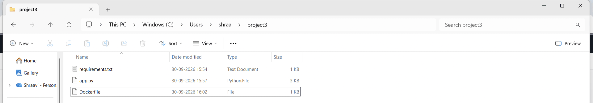

## 3. Configuration Parameters

All settings are passed to the container as environment variables, so no credentials are stored in the code or in the image.

| Variable | Used for | Value in this project |
|---|---|---|
| `AWS_ACCESS_KEY_ID` | AWS access (IAM user) | *(not shown, kept secret)* |
| `AWS_SECRET_ACCESS_KEY` | AWS access (IAM user) | *(not shown, kept secret)* |
| `AWS_DEFAULT_REGION` | AWS region | `us-east-1` |
| `S3_BUCKET` | Source bucket | `shraavi-project3-data-2026` |
| `CSV_KEY` | Source object key | `data/students.csv` |
| `RDS_HOST` | RDS endpoint | `project3-db.cwpkge4qs3tu.us-east-1.rds.amazonaws.com` |
| `RDS_USER` | RDS user | `admin` |
| `RDS_PASSWORD` | RDS password | *(not shown, kept secret)* |
| `RDS_DB` | RDS database name | `studentdb` |
| `RDS_TABLE` | Target table | `students` |
| `GLUE_DB` | Glue database (fallback) | `student_glue_db` |
| `GLUE_TABLE` | Glue table (fallback) | `students_table` |
| `GLUE_S3_LOCATION` | S3 location of the Glue table | `s3://shraavi-project3-data-2026/data/` |

**S3 bucket** `shraavi-project3-data-2026` in US East (N. Virginia):

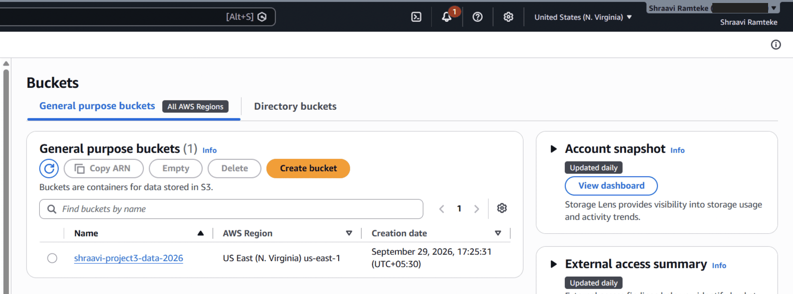

**Source file** `s3://shraavi-project3-data-2026/data/students.csv`:

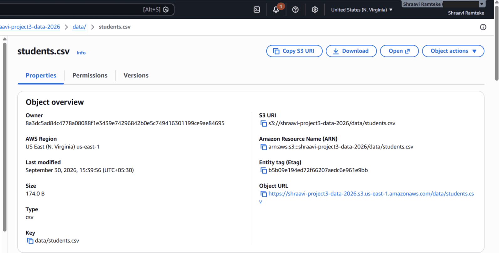

**RDS instance** `project3-db` (MySQL, `db.t4g.micro`), status *Available*:

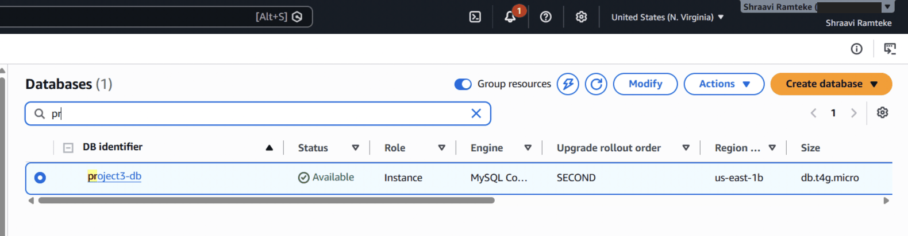

## 4. Step 1: Python Script (`app.py`)

The script contains three main functions:

| Function | What it does |
|---|---|
| `read_csv_from_s3()` | Downloads the object with `boto3` and parses it with `pandas.read_csv`. |
| `push_to_rds(df)` | Builds a `mysql+pymysql://` URL (password URL-encoded with `quote_plus`), creates a SQLAlchemy engine with a 10 second connect timeout, and writes the DataFrame with `to_sql(..., if_exists="append", index=False)`. |
| `fallback_to_glue(df)` | Creates the Glue database (if it does not exist) and an `EXTERNAL_TABLE` of classification `csv` over `GLUE_S3_LOCATION`, with column names taken from the DataFrame and `skip.header.line.count = 1`. |

`main()` reads the CSV, tries `push_to_rds`, and calls `fallback_to_glue` inside the `except` block.

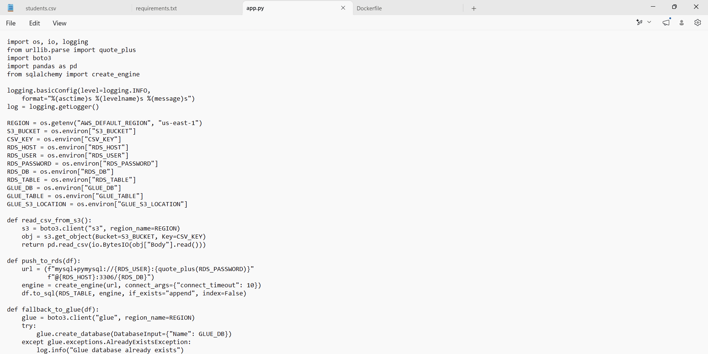

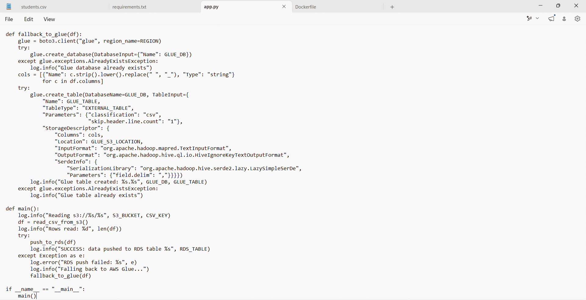

## 5. Step 2: Dockerfile

```dockerfile
FROM python:3.9-slim
WORKDIR /app
COPY requirements.txt .
RUN pip install --no-cache-dir -r requirements.txt
COPY app.py .
CMD ["python", "app.py"]
```

`requirements.txt` is copied and installed before `app.py` is copied, so Docker can reuse the cached dependency layer when only the code changes.

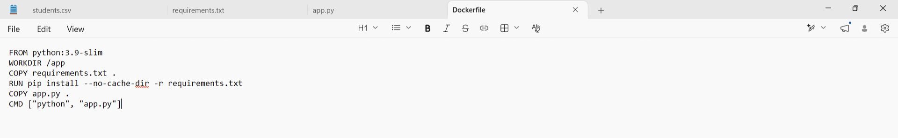

## 6. Step 3: `requirements.txt`

```
boto3
numpy==1.26.4
pandas==2.0.3
sqlalchemy==2.0.30
pymysql
cryptography
```

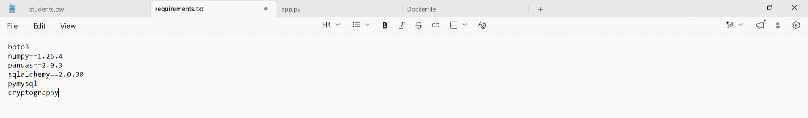

## 7. Step 4: Build the Image and Run the Container

**Build the image**

```bash
docker build -t s3-rds-glue-app .
docker images
```

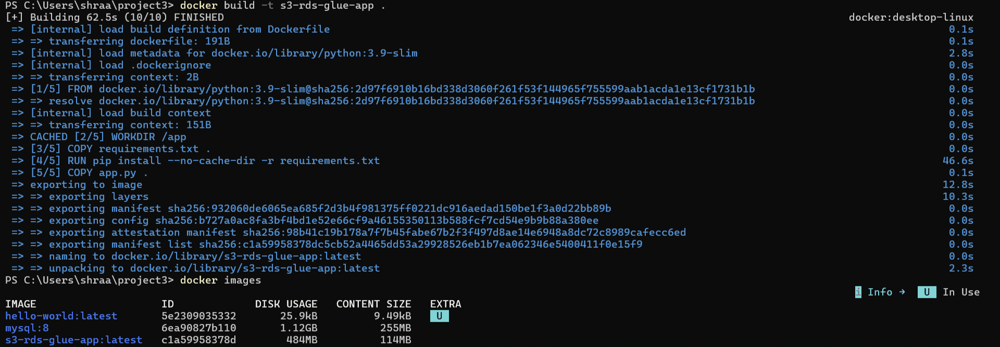

**Run the container** (replace the placeholders with your own values; never commit real credentials):

```bash
docker run --rm \
  -e AWS_ACCESS_KEY_ID=<ACCESS_KEY_ID> \
  -e AWS_SECRET_ACCESS_KEY=<SECRET_ACCESS_KEY> \
  -e AWS_DEFAULT_REGION=us-east-1 \
  -e S3_BUCKET=shraavi-project3-data-2026 \
  -e CSV_KEY=data/students.csv \
  -e RDS_HOST=<RDS_ENDPOINT> \
  -e RDS_USER=admin \
  -e RDS_PASSWORD=<RDS_PASSWORD> \
  -e RDS_DB=studentdb \
  -e RDS_TABLE=students \
  -e GLUE_DB=student_glue_db \
  -e GLUE_TABLE=students_table \
  -e GLUE_S3_LOCATION=s3://shraavi-project3-data-2026/data/ \
  s3-rds-glue-app
```

> **Note:** the script appends rows (`if_exists="append"`). If you run it again against the same table, drop the table first (`DROP TABLE students;`) to avoid duplicate rows.

## 8. Deliverable 2: Container Logs

### 8.1 Normal run: data loaded into RDS

The container read 5 rows from S3 and the log ends with `SUCCESS: data pushed to RDS table students`.

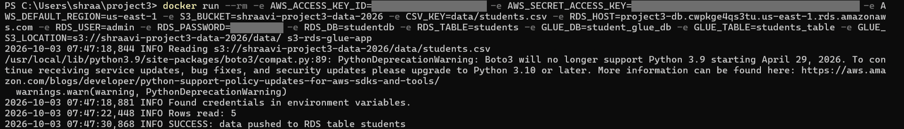

### 8.2 Fallback run: RDS fails, Glue takes over

To test the fallback, the container was started with a deliberately wrong `RDS_PASSWORD`. The RDS write failed with `Access denied (1045)`, the script logged `Falling back to AWS Glue...`, and then `Glue table created: student_glue_db.students_table`.

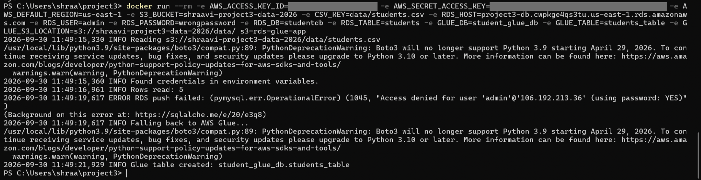

## 9. Deliverable 3: Data in RDS and in the Glue Table

### 9.1 Records in RDS (MySQL)

Query run from a MySQL client container against the `studentdb` database:

```sql
SELECT * FROM students;
```

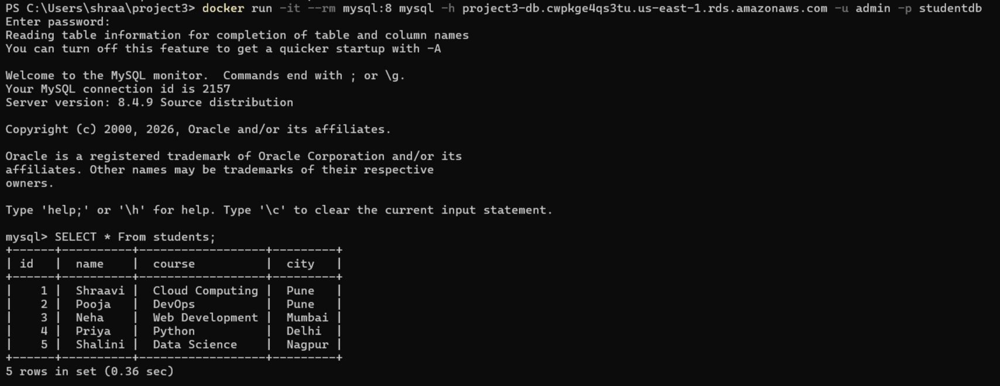

### 9.2 Table in the AWS Glue Data Catalog (fallback)

Glue database `student_glue_db` containing the table `students_table`:

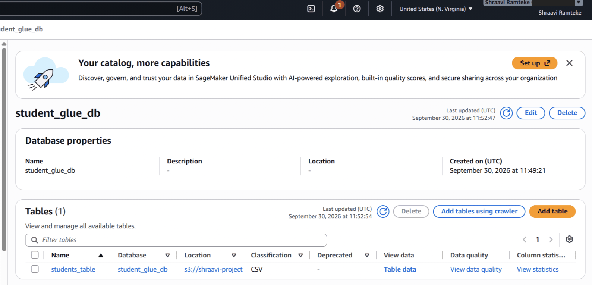

Table details: classification `CSV`, location `s3://shraavi-project3-data-2026/data/`:

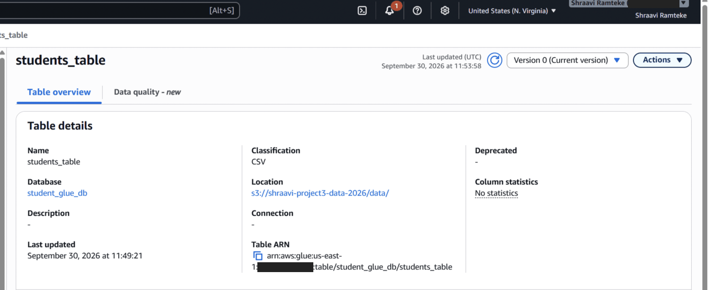

## 10. Challenges and Solutions

| Challenge | Solution |
|---|---|
| Container crashed on import pandas: `ValueError` *"numpy.dtype size changed, may indicate binary incompatibility"* | `pip` had pulled in a newer NumPy (2.x) that is not binary-compatible with pandas 2.0.3. Pinned `numpy==1.26.4` in `requirements.txt` and rebuilt the image; pandas then imported correctly and the script ran. |
| Could not connect to the RDS instance (`ERROR 2003`, port 3306) | Checked that the instance was *Available* and that the security group inbound rule for MySQL/Aurora (3306) allowed my current IP address. |

## 11. Security Notes

- AWS keys and the database password are passed only as environment variables at run time and are not stored in the code, the Dockerfile or the image.
- In the screenshots, the access key, secret key, RDS password and AWS account number have been hidden.
- The IAM access key used for this project should be deactivated or deleted once the project is submitted, and the RDS instance should be stopped or deleted to avoid charges.
